

  

<h1 align="center">LudemOS per PS5</h1>

  Una distribuzione Linux da gioco per <b>PlayStation 5 Slim</b>: si installa sull'SSD M.2 senza chiavette né cavi,
  si avvia dalla home della console col controller e mette i giochi Windows e Linux in un launcher a schermo intero
  pensato per la TV.

  
  
  
  

  <a href="README.md">English</a> · <b>Italiano</b>

  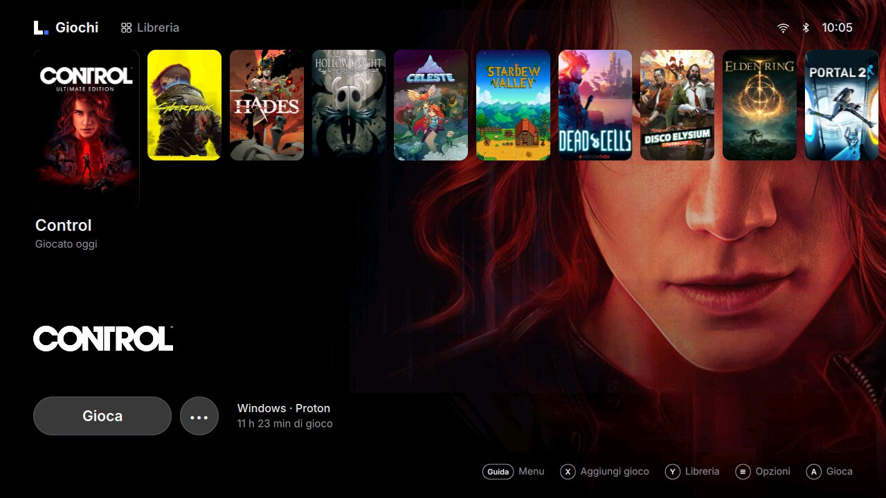

> [!NOTE]
> Questa pagina presenta il lavoro svolto finora. **Il codice sorgente sarà pubblicato in questo repository più
> avanti**, quando il progetto sarà pronto per essere usato anche da altri.

---

## Indice

- [In breve](#in-breve)
- [Cosa funziona](#cosa-funziona)
- [Come si avvia](#come-si-avvia)
- [Installazione](#installazione)
- [Il sistema](#il-sistema)
- [Il desktop](#il-desktop)
- [LudemOS Home, il launcher](#ludemos-home-il-launcher)
- [Problemi risolti](#problemi-risolti)
- [Giochi provati](#giochi-provati)
- [Misure](#misure)
- [LudemNR: upscaler neurale per la GPU della PS5](#ludemnr-upscaler-neurale-per-la-gpu-della-ps5)
- [Limiti noti](#limiti-noti)
- [Crediti](#crediti)
- [Avvertenze](#avvertenze)

---

## In breve

LudemOS parte dal lavoro della comunità [ps5-linux](https://github.com/ps5-linux) (loader, patch del kernel,
strumenti) e ci costruisce sopra un sistema completo e mantenuto, con correzioni proprie per la **PS5 Slim**, che
monta hardware diverso dai modelli su cui il progetto originale è stato provato.

- **Dual boot dalla console.** Un'icona LudemOS nella home della PS5 avvia l'exploit e apre un menu di avvio
  nostro: si sceglie tra *PlayStation 5* e *LudemOS* col controller. Nessun PC, nessuna chiavetta, nessun DNS.
- **Installazione senza hardware esterno.** Kernel e installatore si caricano dalla memoria interna della console;
  l'installatore si collega al Wi-Fi, prepara l'M.2 e scarica il sistema con ripresa dopo le interruzioni.
- **Hardware della Slim sistemato nel kernel.** Wi-Fi e Bluetooth MediaTek MT7921, DualSense via Bluetooth,
  ventola della Slim, intervalli di frequenza CPU/GPU, audio HDMI, HDR10: sette patch (due portate da upstream).
- **Aggiornamenti che non rompono l'avvio.** Repository pacman firmato; il kernel di avvio non si tocca mai, i
  kernel nuovi si installano accanto e vengono confermati solo se la rete funziona.
- **Gestione energetica.** Un demone governa ventola e frequenze: a riposo la console resta a 43 °C, in gioco
  passa al boost in pochi secondi.
- **LudemOS Home.** Launcher a schermo intero in stile console (Qt6/QML + SDL3): giochi Windows con Proton
  **senza Steam**, giochi Linux, Steam facoltativo, preset per gioco, pad virtuale, copertine automatiche.
- **LudemNR.** Ricerca in corso su un upscaler neurale scritto per la GPU della PS5 (RDNA 1, FP16 impacchettato),
  già funzionante dentro un gioco vero.

---

## Cosa funziona

| Area | Stato | Note |
|---|---|---|
| Avvio dalla home della PS5, senza PC | ✅ | icona → exploit → menu → LudemOS in circa due minuti |
| Risveglio col tasto PS del DualSense | ✅ | non serve il tasto di accensione della console |
| Installazione sull'M.2 via Wi-Fi | ✅ | SSD da 1 TB, sistema su `nvme0n1p1` |
| Wi-Fi MT7921 (5 GHz) | ✅ | 867/585 Mbit/s di collegamento, stabile |
| Bluetooth e DualSense | ✅ | tasti, sensori, touchpad, batteria; abbinamento anche via cavo |
| Ventola della Slim | ✅ | obiettivo di temperatura impostato dal kernel e dal demone |
| Frequenze CPU/GPU | ✅ | riposo 1600–1800 / 800–1000 MHz, boost in gioco 3500 / 2230 MHz |
| Desktop KDE Plasma (Wayland) a 4K | ✅ | scala 2, tastiera su schermo |
| Giochi Windows (Proton) e Linux | ✅ | Control e The Witcher 3 Remastered a 1080p e 60 fps fissi con LudemNR |
| Aggiornamenti di sistema e kernel | ✅ | `ludemos-aggiorna`, passaggio con kexec |
| Audio HDMI | ✅ | correzione per il chip HDMI FLAVA3 |
| HDR10 | ✅ | desktop KDE e giochi avviati dal launcher; YCbCr 4:2:2 a 12 bit a 1080p60/2160p60 |
| Spegnimento pulito da Linux | ✅ | `systemctl poweroff` spegne davvero la console |
| Uscita a 120 Hz | ❌ | il ponte HDMI espone solo modi a 60 Hz |
| Stesso abbinamento DualSense in PS5 OS e Linux | ❌ | passando da un sistema all'altro va riabbinato |

---

## Come si avvia

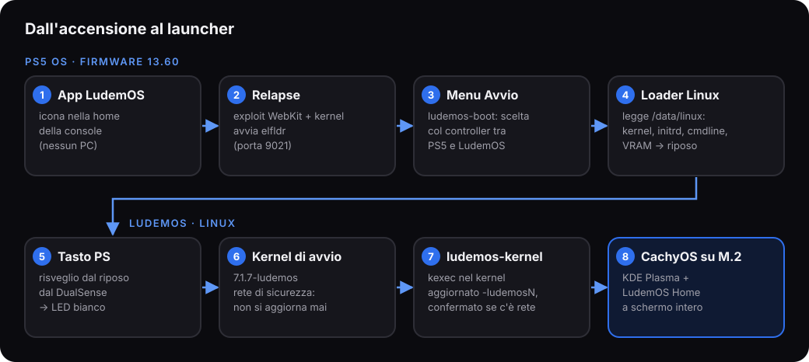

1. **App LudemOS**: un'app nella home della PS5 che conserva nella cache del browser l'exploit
   Relapse (file originali intatti più una piccola patch), il menu di avvio e una pagina di installazione.
2. **Relapse** sfrutta WebKit e il kernel di PS5 OS e avvia `elfldr`, che accetta programmi sulla porta 9021.
   Se `elfldr` è già attivo l'exploit viene saltato.
3. **Menu Avvio** (`ludemos-boot`): un payload nostro che apre il browser della console su una pagina locale con
   le voci lette da `/data/ludemos-boot/avvio.txt` (modificabile via FTP) e, alla scelta, invia i programmi giusti
   a `elfldr`. Si usa col controller: frecce per scegliere, ✕ per avviare, ◯ per chiudere.
4. **Loader Linux**: un fork di `ps5-linux-loader` che legge kernel, initrd, riga di comando e quantità di VRAM da
   `/data/linux/` nella memoria interna e mette la console in riposo.
5. Alla pressione del **tasto PS** la console si risveglia direttamente in Linux.
6. Parte il **kernel di avvio** (7.1.7-ludemos), che non viene mai aggiornato: è la rete di sicurezza.
7. **`ludemos-kernel`** passa con `kexec` al kernel aggiornato più recente (`-ludemosN`) e lo conferma solo se la
   rete funziona; altrimenti all'accensione successiva si resta sul kernel di avvio.
8. **CachyOS** dall'M.2: KDE Plasma con accesso automatico e LudemOS Home a schermo intero.

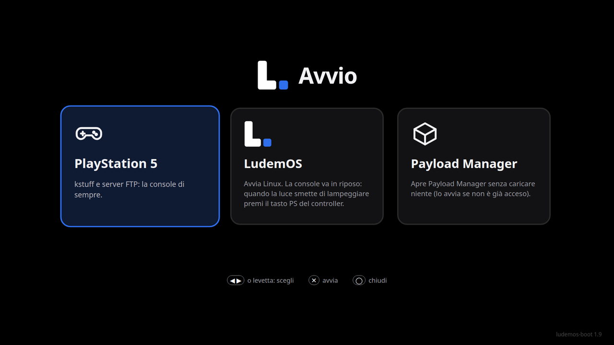

Il menu di avvio (<code>ludemos-boot</code>) come appare sulla TV.

---

## Installazione

> [!IMPORTANT]
> Serve una **PS5 Slim con firmware 13.60** (o un firmware supportato da Relapse e da `ps5-linux-loader`) e un SSD
> M.2 dedicato: lo spazio giochi PS5 su quell'SSD viene perso. Le console con firmware 14.00 o successivi non sono
> supportate. **Non aggiornare il firmware.**

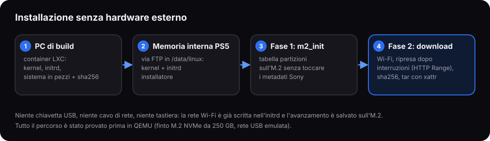

La procedura ufficiale di ps5-linux richiede una chiavetta USB, tastiera e mouse. LudemOS si installa invece
**solo via Wi-Fi**:

1. **Build sul PC** (container LXC Debian): kernel 7.1.7 con le patch PS5 e le nostre, initrd
   dell'installatore (busybox, `wpa_supplicant` con la rete già configurata, `m2_init`, `e2fsprogs`, `dropbear`
   per il controllo via SSH), sistema CachyOS costruito con distrobuilder e diviso in pezzi con sha256.
2. **Memoria interna PS5**: con l'exploit attivo e il server FTP, kernel e initrd dell'installatore vanno in
   `/data/linux/`; poi si invia il loader.
3. **Fase 1**: `m2_init` scrive sull'M.2 una tabella delle partizioni con una sola partizione Linux, lasciando
   intatti i metadati che PS5 OS controlla (così la console non chiede di riformattare). Si torna in PS5 OS per
   verificarlo.
4. **Fase 2**: formattazione ext4 e download del sistema dal PC con ripresa (`wget -c`), controllo sha256 di ogni
   pezzo ed estrazione con `tar` GNU che conserva xattr, capability e setuid (quello di busybox no).
5. **Avvio normale**: in `/data/linux/` vanno il kernel e l'initrd del sistema con `root=LABEL=ludemos-m2`.

Ogni fase scrive lo stato a schermo e risponde via SSH, con un timeout su ogni attesa. Tutto il percorso è stato
provato prima in **QEMU** con il kernel PS5 (driver specifici esclusi con `initcall_blacklist`), un finto M.2 NVMe
da 250 GB e una rete USB emulata: lì sono emersi e sono stati corretti i problemi dell'installatore prima di
toccare la console.

### Impostazioni della PS5

- Risparmio energia → Funzioni in modalità riposo → Alimentazione porte USB: **Sempre**.
- HDMI → **disattivare** "Abilita collegamento dispositivo HDMI".
- Aggiornamenti automatici **spenti**.
- Per le sessioni Linux l'exploit va lanciato **senza kstuff** (impedisce il riposo e blocca l'avvio di Linux).

---

## Il sistema

La base è l'immagine CachyOS di ps5-linux; uno script applica alla ricetta
ufficiale una serie di modifiche esplicite e controllate, e un secondo script verifica il risultato
(servizi attivi, file presenti, pacchetti) prima di produrre l'archivio.

**Pacchetti nostri** (repository pacman `[ludemos]` firmato GPG):

| Pacchetto | Contenuto |
|---|---|
| `linux-ps5-ludemos` | kernel di avvio 7.1.7, bloccato con `IgnorePkg` |
| `linux-ps5-ludemos-agg` | kernel aggiornati `-ludemosN`, compilati con `-march=x86-64-v3 -mtune=znver2` |
| `ludemos-tools` | strumenti di sistema (tabella sotto) |
| `ludemos-home` | il launcher |

**Strumenti di `ludemos-tools`**:

| Strumento | A cosa serve |
|---|---|
| `ludemos-fand` | ventola e frequenze: profili Silenzioso / Bilanciato / Prestazioni, boost quando c'è un gioco, protezione a 92 °C, protezione dell'SSD M.2 sopra i 75 °C |
| `ludemos-kernel` | passaggio con `kexec` al kernel aggiornato, conferma con rete funzionante, un solo passaggio per accensione |
| `ludemos-aggiorna` | aggiornamento del sistema (`pacman -Syu`), `--passa` per passare subito al kernel nuovo |
| `ludemos-dualsense` | abbinamento del DualSense via cavo: scrive nel controller indirizzo e chiave e li registra in BlueZ; parte da solo collegando il cavo |
| `ludemos-schermo` | ripristina il segnale video quando la TV viene spenta e riaccesa |
| `ludemos-frequenze` | misure: frequenza reale della CPU (APERF/MPERF) e temperature per N secondi |
| `ludemos-nome` | identità del sistema (nome e logo LudemOS), rimessa dopo gli aggiornamenti del sistema di base |
| `ludemos-moduli-*` | hook pacman che salvano e rimettono i moduli del kernel in uso durante gli aggiornamenti |
| `gamescope-session-ps5` | sessione Gamescope + Steam con registro completo |
| regole udev | Bluetooth "fantasma" del chip, abbinamento automatico del DualSense |

Configurazione di serie: Wi-Fi con risparmio energetico spento, zram, `systemd-timesyncd` (sotto Linux l'orologio
della PS5 parte dal 1970), GTT a 10 GiB, SSH solo con chiave, KDE senza sospensione né blocco schermo.

---

## Il desktop

Sotto il launcher c'è un desktop **KDE Plasma 6** completo su Wayland, a 3840×2160 con scala 2, raggiungibile in
ogni momento da Accensione → Desktop (il tasto PS riporta al launcher). Catture fatte sulla console.

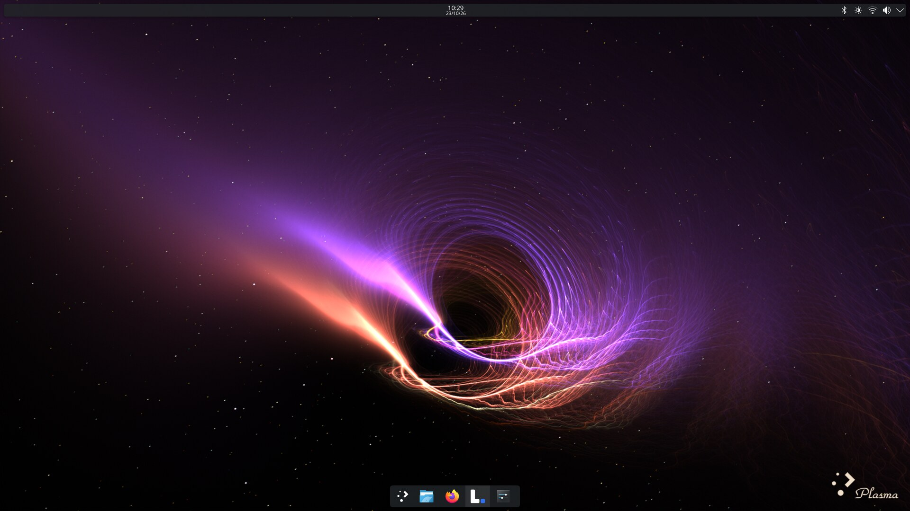

<table>
  <tr>
    <td width="50%">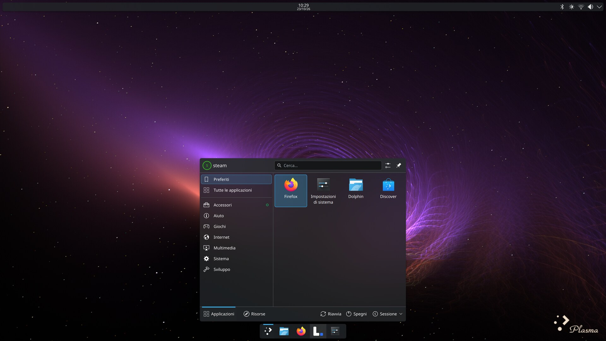 <b>Menu delle applicazioni</b>: Firefox, Dolphin, Discover, impostazioni di sistema.</td>
    <td width="50%">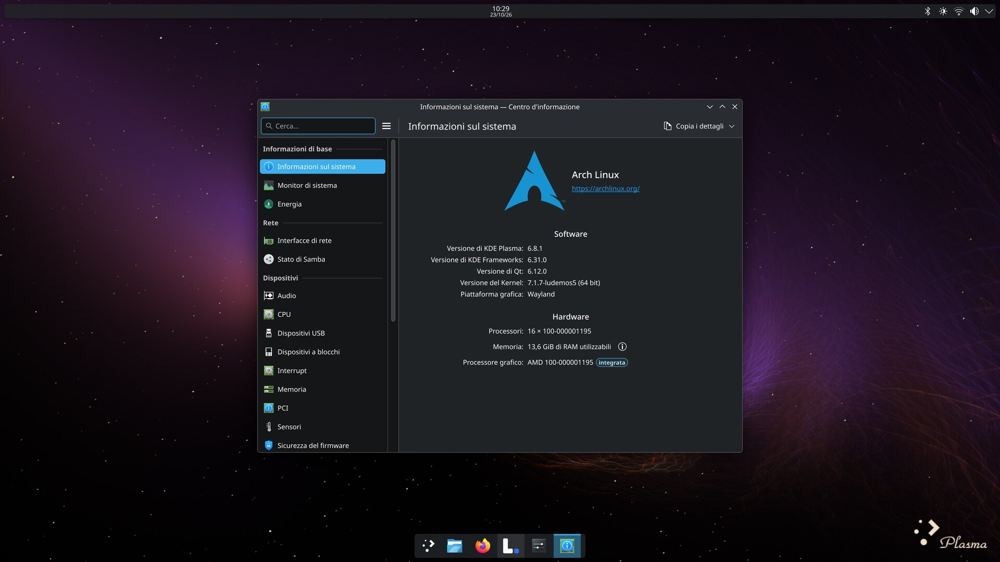 <b>Informazioni sul sistema</b>: LudemOS PS5, Plasma 6.8.1, Qt 6.12, kernel 7.1.7-ludemos5, APU AMD della PS5 (16 thread), 13,6 GiB di RAM disponibili.</td>
  </tr>
</table>

---

## LudemOS Home, il launcher

Qt6/QML + SDL3 · C++20

Gira a schermo intero dentro KDE e **non dipende da Steam**: i giochi Windows partono con Proton tramite
`umu-run`, un prefisso per gioco. Si comanda col controller (DualSense, pad Xbox e compatibili) o con la tastiera.
Lo stile riprende l'interfaccia delle console: artwork a tutto schermo, icone verticali, barra del menu flottante.

<table>
  <tr>
    <td width="50%">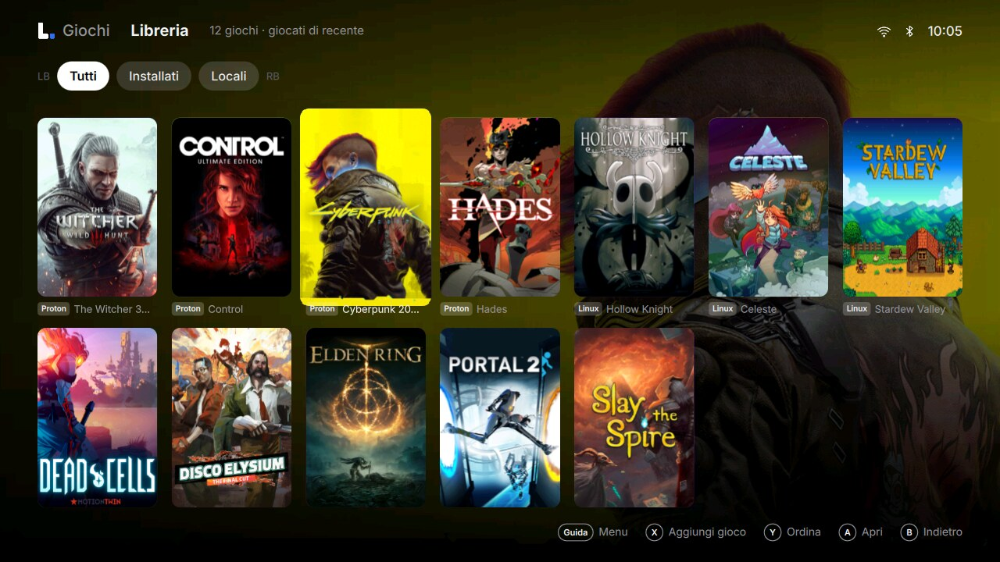 <b>Libreria</b>: filtri, ordinamento, Proton o Linux per ogni gioco.</td>
    <td width="50%">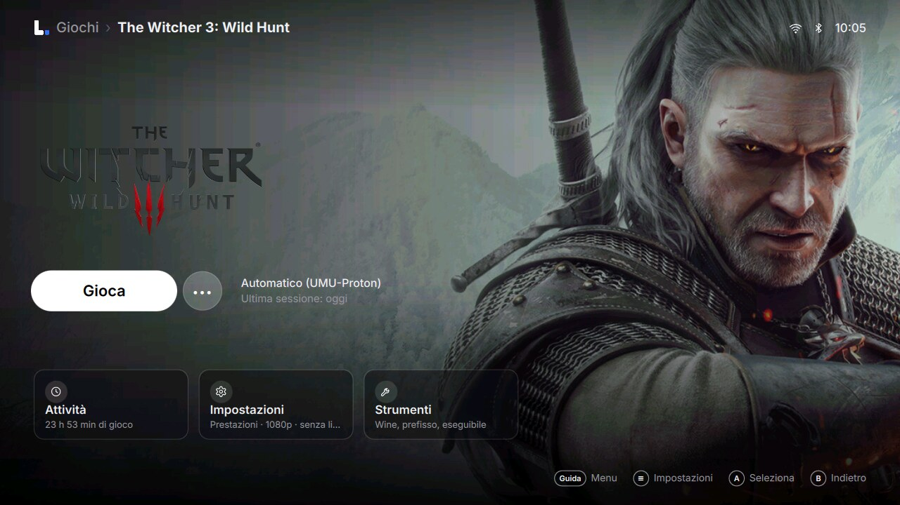 <b>Pagina del gioco</b>: attività, impostazioni, strumenti.</td>
  </tr>
  <tr>
    <td>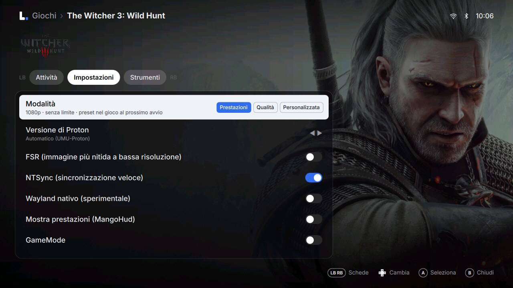 <b>Impostazioni per gioco</b>: preset Prestazioni / Qualità, versione di Proton, FSR, NTSync, MangoHud.</td>
    <td>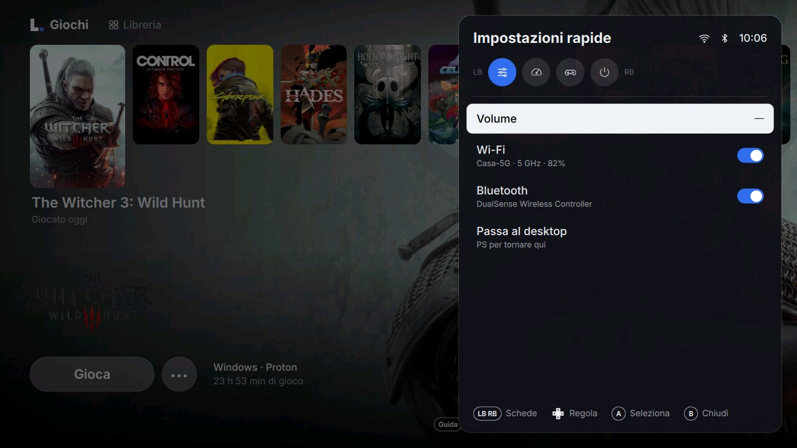 <b>Impostazioni rapide</b> (Guida tenuto): volume, Wi-Fi, Bluetooth, ventola, limite fps, controller.</td>
  </tr>
  <tr>
    <td>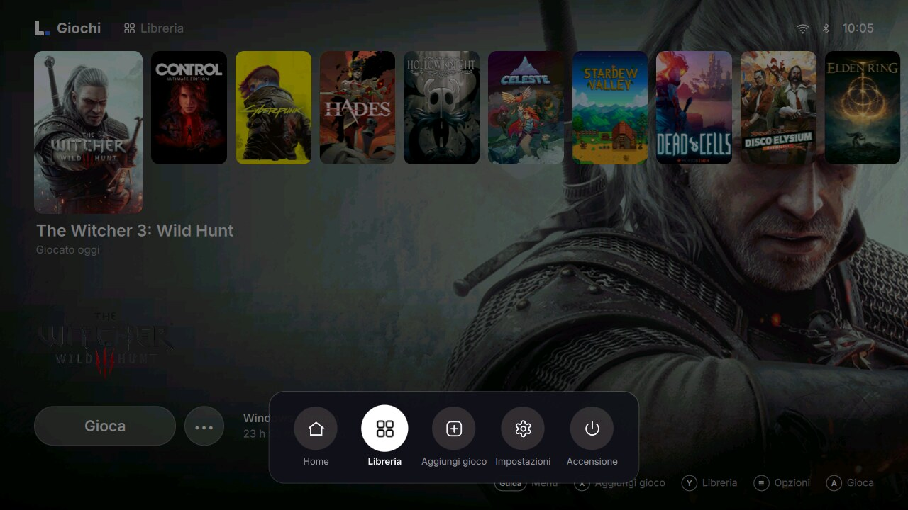 <b>Menu</b> (tasto PS/Guida), anche sopra un gioco in corso.</td>
    <td>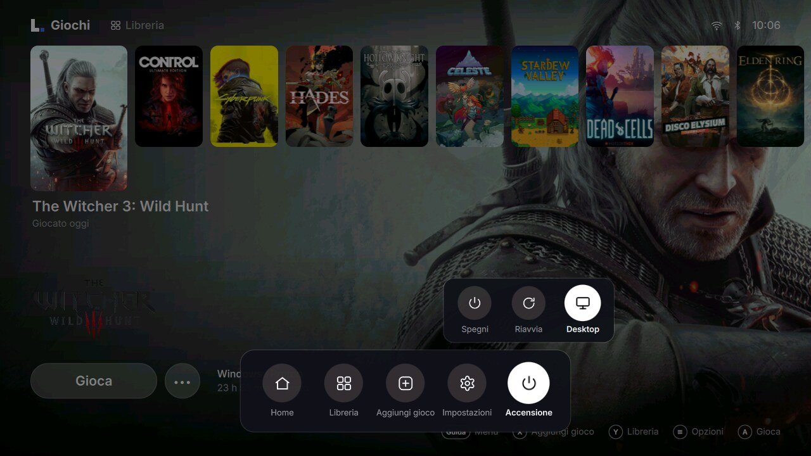 <b>Accensione</b>: spegni, riavvia, passa al desktop.</td>
  </tr>
  <tr>
    <td> <b>Aggiungi gioco</b>: da chiavetta, cartella di rete o M.2; copia o installer.</td>
    <td>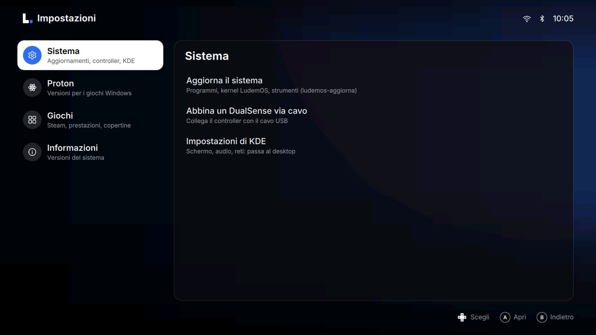 <b>Impostazioni</b>: sistema, versioni di Proton, giochi, informazioni.</td>
  </tr>
</table>

**Funzioni principali**

- **Giochi Windows senza Steam.** Proton per gioco: automatico (Proton-CachyOS se presente, altrimenti
  UMU-Proton), GE-Proton scaricato con verifica sha512, versioni di Steam o installate a mano. Installer Windows
  eseguiti nel prefisso del gioco, poi scelta dell'eseguibile; `winecfg`, `winetricks`, ripristino del prefisso.
- **Preset per gioco**: modalità *Prestazioni* (1080p a 60 fps) e *Qualità*. Il
  launcher scrive solo le voci elencate nei file di configurazione del gioco (JSON o INI), conservando tipi e
  formattazione, e salva l'originale per poterlo ripristinare.
- **Pad virtuale**: per ogni pad reale crea un pad `uinput` con l'identità del pad
  virtuale di Steam e nasconde quello reale al gioco. Risolve il personaggio che continua a muoversi quando
  Proton legge direttamente certi controller, senza bisogno di Steam Input.
- **Giochi Steam facoltativi**: letti solo se attivati; le opzioni di avvio (`localconfig.vdf`) sono scritte dal
  launcher a Steam chiuso.
- **Copertine automatiche** dallo store di Steam per i giochi locali, cercate per titolo.
- **Cartella da scansionare** scelta dall'utente: ogni sottocartella diventa un gioco (installer esclusi). Nessuna
  scansione senza consenso.
- **Durante il gioco**: il tasto PS riporta il launcher sopra il gioco (con uno script KWin via D-Bus, perché la
  protezione dal furto del fuoco rifiuta le richieste normali), poi *Torna al gioco* o *Esci dal gioco*, che chiude
  anche i processi staccati dentro il contenitore di Steam.
- **HDR per gioco**: se il desktop KDE è in HDR, i giochi partono in Gamescope con l'HDR attivo e Proton offre al
  gioco un'uscita HDR10, quindi compare l'opzione HDR del gioco.
- **Boost in gioco**: il launcher marca il processo del gioco (`LUDEMOS_GIOCO=1`) e `ludemos-fand` alza le
  frequenze.
- **Sistema**: ventola, Wi-Fi, Bluetooth, volume, aggiornamenti, abbinamento DualSense, MangoHud a livelli,
  GameMode, Gamescope annidato per l'uscita a 1080p a pixel interi sulla TV 4K.

---

## Problemi risolti

Ogni voce riporta il sintomo, la causa trovata e la correzione.

### Wi-Fi

<b>La PS5 Slim non ha il Wi-Fi previsto dal progetto originale</b>

- **Sintomo**: nessuna interfaccia Wi-Fi.
- **Causa**: questa Slim monta un **MediaTek MT7921** (`14c3:7961`), non il Marvell IW620 delle altre revisioni, e
  il kernel ufficiale non attiva il driver PCIe.
- **Correzione**: `CONFIG_MT7921E=m` con `disable_aspm=1`, firmware ridistribuibile da `linux-firmware`.

<b>"driver own failed": il chip non si accende</b>

- **Causa**: sul ramo 7.2 del kernel PS5 l'inizializzazione del controller USB Salina è stata tolta; senza, il
  chip MT7921 resta spento. È anche la causa dei fallimenti segnalati da altri utenti sul 7.2.3.
- **Correzione**: kernel 7.1.7 con l'inizializzazione Salina attiva.

<b>La console si blocca circa 10 secondi dopo l'avvio del Wi-Fi</b>

- **Sintomo**: "xHCI host controller not responding, assume dead", poi blocco totale.
- **Causa**: il risparmio energetico dell'MT7921 (runtime PM, sonno profondo) fa passare continuamente il chip tra
  driver e firmware; sulla Slim il chip condivide il collegamento con il controller Salina, che cade.
- **Correzione**: patch `0001` (risparmio energetico spento nel driver), `pcie_aspm=off`,
  `usbcore.autosuspend=-1`, power save spento in NetworkManager.

<b>WPA2 nell'initrd: "key addition failed"</b>

- **Causa**: il kernel carica `ccm` con `/sbin/modprobe`, che nell'initrd busybox mancava; `wpa_cli` cercava
  `/var/run`.
- **Correzione**: `modprobe` vero nell'initrd e `/var/run` collegato a `/run`.

### Bluetooth e DualSense

<b>Il DualSense non si collega: i pacchetti partono sull'endpoint sbagliato</b>

- **Sintomo**: abbinamento riuscito ma il controller non si collega; nessun "Number of Completed Packets".
- **Causa**: il Bluetooth dell'MT7921 (`0e8d:3603`) ha due endpoint bulk OUT (0x01 e 0x02); `btusb` prende il
  primo, ma i dati ACL vanno sul secondo.
- **Correzione**: patch `0002` per `btusb`.

<b>"security block" sul canale del controller</b>

- **Causa**: il controller Salina non ha interrupt e viene letto a intervalli di circa 20 ms. La richiesta di
  canale del DualSense arriva prima dell'evento "Encryption Change", anche se la chiave è già stata consegnata, e
  Linux la rifiuta.
- **Correzione**: patch `0003` per L2CAP: in quel caso si risponde "in attesa" e il canale viene accettato appena
  la cifratura è attiva.

<b>Un secondo adattatore Bluetooth "fantasma"</b>

- **Causa**: le interfacce 3 e 4 del chip vengono viste come un altro adattatore che fallisce il reset.
- **Correzione**: regola udev che le disattiva.

<b>Abbinamento via cavo, come su PS5 OS</b>

- `ludemos-dualsense` legge dal controller collegato via USB il suo indirizzo (report HID 0x09), gli scrive
  l'indirizzo della console e una chiave nuova (report 0x0A), salva la chiave nel formato di BlueZ e riavvia
  `bluetoothd`. Una regola udev lo avvia collegando il cavo e salta se il controller è già abbinato.
- PS5 OS usa lo **stesso indirizzo** Bluetooth della console: per capire se serve riabbinare, lo strumento
  controlla se il controller si è davvero collegato via Bluetooth in questa accensione.

### Ventola, temperature, frequenze

<b>La ventola della Slim ignora i comandi</b>

- **Causa**: la scheda della Slim (famiglia 05) non è nota al driver, che non carica la sua tabella e lascia
  l'obiettivo di fabbrica a 91 °C; l'unico comando efficace è l'obiettivo di temperatura scritto a sistema avviato.
- **Correzione**: patch `0004`: obiettivo di avvio a 80 °C scritto e riletto ogni 2 secondi finché il firmware lo
  conferma (con la maschera corretta per la revisione GDDR6). Poi `ludemos-fand` tiene 75 °C e lo riscrive se il
  firmware lo cambia.

<b>CPU sempre a 3,2 GHz anche al desktop</b>

- **Causa**: `amdgpu` non conosce il firmware di gestione energetica di Sony (con `dpm=1` il ponte HDMI si
  blocca), quindi decide il firmware; il driver offriva solo "boost sì/no".
- **Correzione**: patch `0005`: `/sys/class/misc/mp1/intervallo` per impostare intervalli di frequenza CPU e GPU.
  Misurato che il firmware, dentro l'intervallo, tiene sempre il massimo; scelto come riposo 1600–1800 /
  800–1000 MHz: da 54 °C a **43 °C** a riposo, desktop ancora fluido.
- `ludemos-fand` passa al boost quando trova un gioco (processi di Steam o variabile del launcher) e torna al
  riposo 30 secondi dopo l'uscita.

<b>I giochi non Steam restavano alle frequenze di riposo</b>

- **Causa**: il demone riconosceva solo i giochi avviati da Steam.
- **Correzione**: il launcher mette `LUDEMOS_GIOCO=1` nell'ambiente del gioco e `ludemos-fand` lo cerca.

<b>SSD M.2 senza dissipatore</b>

- 59–60 °C a riposo. `ludemos-fand` abbassa l'obiettivo della ventola a 65 °C quando l'NVMe supera i 75 °C e
  torna normale sotto i 68 °C.

### Video, VRAM e audio

<b>Gamescope si chiude dopo qualche minuto di gioco ("fatal flip error")</b>

- **Analisi**: core dump studiato con gdb, simboli da debuginfod e librerie copiate dalla console: errore
  `ENOMEM` nel commit DRM.
- **Causa**: su questa GPU l'immagine da mostrare può stare solo in VRAM, e con 512 MB e uscita 4K la VRAM finiva.
- **Correzione**: VRAM a 1 GB (`vram.txt` = `0x40000000`) e GTT a 10 GiB: Control in DX12 senza crash.

<b>"Nessun segnale" dopo aver spento e riacceso la TV</b>

- **Causa**: il kernel rilegge l'EDID ma non avvisa KDE; il chip HDMI resta senza configurazione video.
- **Correzione**: servizio `ludemos-schermo`: segue il registro del kernel e, dopo l'ultima lettura EDID, cambia
  modalità a una frequenza vicina e torna indietro, riconfigurando il chip.

<b>Audio HDMI a scatti</b>

- **Correzione**: patch `0006`, portata dalla correzione della comunità ps5-linux per il chip HDMI FLAVA3 (valore
  `Naud` diverso nell'encoder audio), con una riga nel registro che indica il chip rilevato.

<b>HDR: immagine sbiadita, la TV non passava in HDR</b>

- **Analisi**: KDE vedeva lo schermo come "HDR incapable" perché l'immagine di base lo spegne apposta (la PS5 passa
  da un chip che converte DisplayPort in HDMI). Tolto quel blocco, la scheda video mandava un segnale HDR corretto ma
  l'immagine era slavata: il chip HDMI restava configurato per l'SDR e non diceva alla TV che il segnale era HDR.
- **Correzione**: patch `0007`, adattata dal lavoro della comunità ps5-linux sul chip FLAVA3: nel chip si scrivono il
  pacchetto dei metadati HDR (DRM InfoFrame) e la colorimetria BT.2020, e in HDR l'uscita passa a YCbCr 4:2:2 a 12 bit,
  che occupa la stessa banda HDMI dell'RGB a 8 bit. Il launcher poi porta l'HDR ai giochi attraverso Gamescope.
  Risultato: la TV mostra HDR10 con i colori giusti.

<b>Giochi Wine minuscoli o a risoluzione sbagliata sulla TV 4K</b>

- KDE usa la scala 2 e Xwayland espone solo il 4K nativo e modi 4:3: a schermo intero esclusivo i giochi non
  trovano 1920×1080 e tornano al 4K pieno. I preset usano la modalità senza bordi con risoluzione di calcolo più
  bassa; il launcher imposta i DPI di Wine (192 sul desktop, 96 dentro Gamescope).

### Giochi e controller

<b>Il personaggio continua a muoversi da solo</b>

- **Causa**: con alcuni controller, Proton letto direttamente via SDL fuori da Steam Input dà assi sbagliati;
  dentro un Gamescope annidato, invece, Steam Input non manda proprio i comandi al gioco.
- **Correzione**: pad virtuale del launcher, con la stessa identità e le stesse variabili del pad virtuale di
  Steam; i giochi Steam partono senza Gamescope annidato.

<b>60 fps a contatore ma movimento "incerto"</b>

- **Causa**: due limitatori insieme (VSync del gioco e limite di DXVK/VKD3D o di Gamescope).
- **Correzione**: nei preset resta solo il VSync del gioco.

<b>"Esci dal gioco" lasciava il gioco aperto</b>

- **Causa**: i processi dentro il contenitore di Steam (pressure-vessel) si staccano dal processo padre.
- **Correzione**: il launcher aggiorna ogni 2 secondi l'insieme dei PID del gioco (anche staccati) e alla chiusura
  manda SIGTERM a tutti, poi SIGKILL dopo 5 secondi.

<b>Il launcher non si chiudeva allo spegnimento</b>

- **Causa**: SDL intercetta SIGTERM.
- **Correzione**: `SDL_HINT_NO_SIGNAL_HANDLERS`.

<b>Il tasto PS non riportava il launcher dopo "Desktop"</b>

- **Causa**: su Wayland Qt non sa se la finestra è ridotta a icona.
- **Correzione**: un segno proprio più il controllo della finestra attiva.

### Avvio, aggiornamenti, sessione

<b>Un aggiornamento del kernel lasciava il controller senza driver</b>

- **Causa**: aggiornando `linux-ps5-ludemos-agg` pacman toglieva i moduli del kernel in esecuzione; al primo
  collegamento del pad `xpad` non c'era più.
- **Correzione**: hook pacman `ludemos-moduli-salva` / `ludemos-moduli-rimetti` che conservano i moduli del kernel
  in uso.

<b>Il browser del menu di avvio non si chiudeva</b>

- **Analisi**: il browser della PS5 vive dentro il processo della home (`SceShellUI`): chiuderlo dal payload
  significa riavviare la home. Provate cinque versioni del menu.
- **Correzione**: nessuna chiusura dal payload; la pagina si chiude col tasto ◯ (gesto dell'utente, accettato dal
  browser), come fa Payload Manager.

<b>Altre correzioni</b>

- Menu di avvio con pagina bianca: il server a connessione singola si bloccava per le preconnessioni del browser →
  un thread per connessione.
- Steam: avvio con `-steamos3` (altrimenti "Passa al desktop" sembra bloccarsi) e piccoli sostituti di
  `steamos-update` / `steamos-select-branch`.
- Orologio: sotto Linux la PS5 parte dal 1970 → `systemd-timesyncd`.
- Tastiera su schermo in KDE: Onboard con regola KWin (classe esatta "Onboard", senza fuoco, sempre sopra).
- distrobuilder in un container LXC non privilegiato: patch e mount namespace privato, altrimenti lo smontaggio
  toglieva i dispositivi `/dev` al container.
- Initrd busybox: `tar`, `blkid`, `mkfs.ext4` veri con percorsi completi (le versioni busybox perdevano
  capability e xattr).
- Nome del sistema: l'immagine di base si presentava come "Arch Linux"; ora è LudemOS, e un hook di pacman lo
  rimette dopo gli aggiornamenti del sistema di base.

---

## Giochi provati

Provati sulla console, con TV 4K a 60 Hz, dal launcher LudemOS Home con Proton-CachyOS.

| Gioco | API | Risoluzione | Upscaler | Risultato |
|---|---|---|---|---|
| **Control** | DX12 | 1080p | **LudemNR** | **60 fps fissi** |
| **The Witcher 3: Wild Hunt** (Remastered, next-gen) | DX12 | 1080p (calcolo 960×540) | **LudemNR** al posto di XeSS | **60 fps fissi**, immagine nitida e senza scie |

---

## Misure

**Frequenze e temperature** a riposo (CPU+GPU sono un solo chip, sensore Tctl), circa 2 minuti per gradino:

| Intervallo CPU / GPU (MHz) | CPU reale | Chip |
|---|---|---|
| deciso dal firmware Sony | 3187 MHz | 54–55 °C |
| 2400–3200 / 1600–2000 | 3188 MHz | 55 °C |
| 1600–2400 / 800–1400 | ~2500 MHz | 46 °C |
| **1600–1800 / 800–1000** (riposo scelto) | ~1960 MHz | **43–45 °C** |

In gioco (Control): boost in pochi secondi, CPU a 3490 MHz, chip 53–74 °C, 60 fps.

**GPU** (gfx1013, RDNA 1 con istruzioni per il ray tracing): picco misurato **9,9 TFLOPS FP32** e **20,1 TFLOPS
FP16**, uguale al valore teorico; prodotto scalare int8 non accelerato (per questo XeSS è lento e FSR 4 non è
possibile).

---

## LudemNR: upscaler neurale per la GPU della PS5

Lavoro di ricerca, non ancora integrato nel launcher.

L'idea: qualcosa di simile al DLSS, ma scritto per la GPU della PS5, in tutti i giochi che hanno già un upscaler
temporale (DLSS, FSR 2/3, XeSS). Gli ingressi (colore a bassa risoluzione, profondità, vettori di moto) arrivano da
**OptiScaler**, a cui è stato aggiunto un modulo `ludemnr`.

- **Rete nostra**, piccola, addestrata con PyTorch su dati sintetici generati da noi (niente pesi di terzi).
- **Esecuzione in Vulkan dentro la command list D3D12** tramite l'interop di vkd3d-proton: passando da DXIL il
  driver non usa le istruzioni FP16 a coppie e la potenza si dimezza.
- **Accumulo temporale** nei pass D3D12 (riproiezione, pesi gaussiani rispetto al campione più vicino, scatola dei
  colori), verificato bit per bit contro la copia PyTorch (62 dB: solo arrotondamenti FP16).
- **Compilazione dal PC Linux** con clang-cl, lld-link e Windows SDK; trovato e corretto un caso in cui clang
  riduceva una funzione a una sola istruzione `int3` (il gioco si chiudeva all'avvio).

| Rete U-Net, 540p → 1080p | Costo sulla PS5 (boost) |
|---|---|
| minima, 8 canali | **1,0 ms** |
| piccola, 16 canali | 3,5 ms |
| grande, 32 canali | 17,2 ms |

Risultato attuale su una scena di prova mai vista (960×540 → 1080p): bilineare 26,8 dB, LudemNR **30,1 dB in
0,32 ms**. Nei giochi: **Control** e **The Witcher 3 Remastered** in DX12 a 1080p e **60 fps fissi** con LudemNR
(vedi [Giochi provati](#giochi-provati)).

---

## Limiti noti

- Ogni avvio di Linux passa dall'exploit: dipende dal lavoro dei ricercatori di sicurezza sul firmware 13.60.
- Solo 60 Hz garantiti (il ponte DP→HDMI espone tre famiglie di modi).
- Passando da PS5 OS a Linux e viceversa il DualSense va riabbinato: la console usa lo stesso indirizzo Bluetooth
  con chiavi diverse.
- Carico della GPU non leggibile (gestione energetica del driver spenta per compatibilità col firmware Sony).

---

## Crediti

LudemOS esiste grazie al lavoro di altri progetti open source:

- [ps5-linux](https://github.com/ps5-linux): loader, patch del kernel e driver PS5, strumenti `m2_init`,
  immagini di base, supporto HDR per il chip HDMI FLAVA3.
- [ps5-payload-dev](https://github.com/ps5-payload-dev): SDK dei payload ed `elfldr`.
- [Relapse](https://github.com/ntfargo/Relapse-Exploit) (ntfargo e collaboratori): exploit WebKit e kernel.
- [WebKit Autoloader](https://github.com/itsPLK/ps5-webkit-autoloader) e
  [Payload Manager](https://github.com/itsPLK/ps5-payload-manager) (itsPLK): schema dell'app e del menu.
- [j4lenj/ps5-mt7921-wifi](https://github.com/j4lenj/ps5-mt7921-wifi): primo supporto MT7921 sulla Slim.
- [CachyOS](https://cachyos.org), [Mesa](https://mesa3d.org) (supporto della GPU PS5),
  [umu-launcher](https://github.com/Open-Wine-Components/umu-launcher), Proton,
  [OptiScaler](https://github.com/optiscaler/OptiScaler), KDE Plasma, SDL, Qt.

---

## Avvertenze

Questa pagina presenta il lavoro svolto. Il codice sorgente, gli script e i file del sistema non sono ancora
pubblicati: lo saranno più avanti, in questo repository.

Progetto personale, non affiliato a Sony Interactive Entertainment. Le immagini dei giochi nelle schermate servono
solo a mostrare il launcher e appartengono ai rispettivi proprietari.
